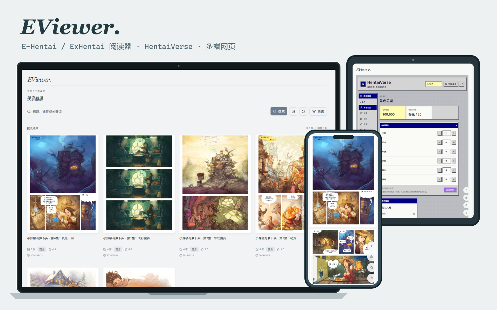
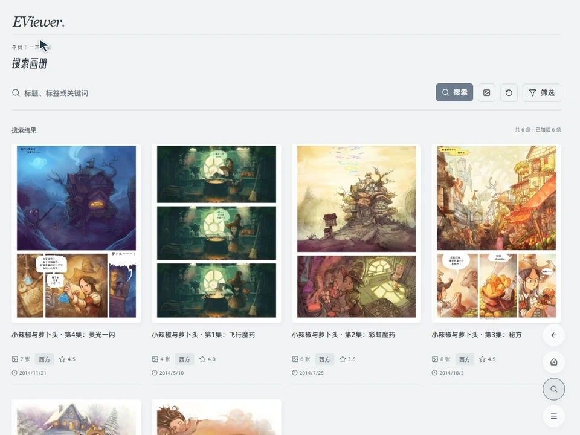
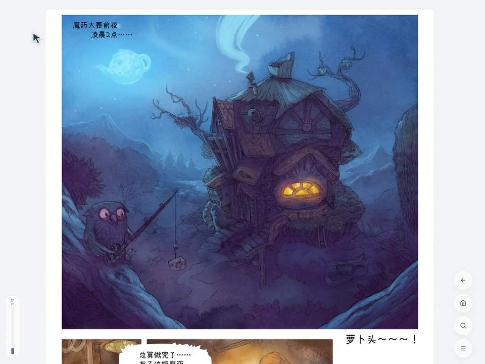
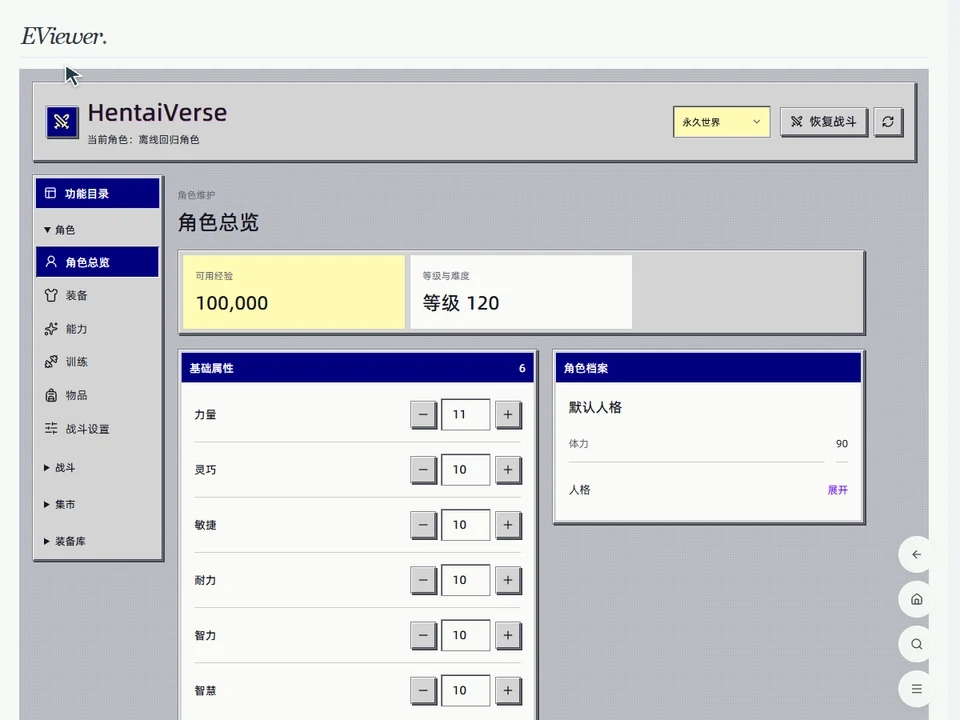
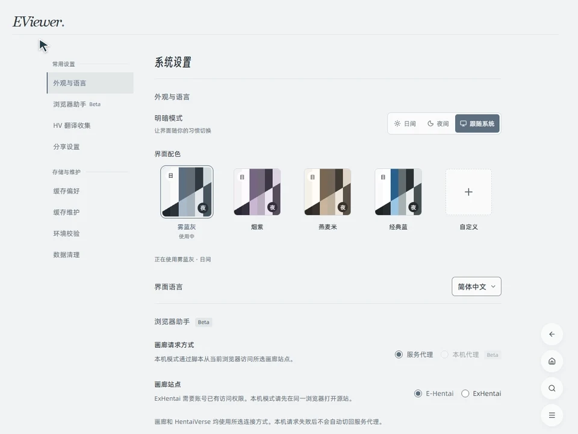

# EViewer

[](LICENSE.txt)
[](https://vuejs.org/)
[](https://workers.cloudflare.com/)

面向 E-Hentai / ExHentai 的多端网页客户端，支持画廊搜索、阅读和收藏，并集成 HentaiVerse 功能。

**[立即使用 EViewer](https://docs.gghf.top/projects/eviewer/)** · [使用文档](docs/README.md) · [自行部署](docs/deployment.md)



## 开始使用

访问 **[https://docs.gghf.top/projects/eviewer](https://docs.gghf.top/projects/eviewer/)**，推荐搭配浏览器助手使用本机代理。

> [!TIP]
> **页面打不开，或画廊加载不出来？**
>
> - 公共服务代理的出口由多人共享，可能受到源站的 IP 访问限制，导致画廊无法加载。遇到这种情况，可以安装浏览器助手并切换到**本机代理**。
> - 在线站点目前仅允许中国大陆、香港和台湾地区的 IP 访问。如果你使用的网络或代理节点位于其他地区，可能会被 Cloudflare 拦截；请切换到允许访问的地区后重试。
>
> 这些情况通常与访问路径有关，不代表你的操作有误，也不一定是 EViewer 出现了故障。

### 推荐：本机代理

安装浏览器助手后，EViewer 可以通过你当前浏览器的源站会话发起请求。推荐优先使用本机代理，既能减少公共站点的代理流量，也能避免所有请求共用服务端出口。

1. 在浏览器中登录源站。
2. 安装适用于当前浏览器的脚本管理器和 EViewer 浏览器助手。
3. 打开 EViewer，在「系统设置 → 浏览器助手」中选择本机代理。
4. 前往「账号信息」检查登录状态。

浏览器助手支持 Tampermonkey 和 Userscripts。iPhone / iPad 请在 Safari 普通标签页中使用 Userscripts；Android 需要选择支持对应扩展的浏览器。

### 备选：服务代理

如果当前设备不方便使用浏览器助手，可以选择服务代理，并在「账号信息」中配置源站登录态。服务代理会通过 Cloudflare Worker 访问源站。

画廊和 HentaiVerse 使用同一连接方式。本机请求失败时不会自动切换为服务代理；访问 ExHentai 仍需要账号已有相应权限。

完整步骤见[首次使用指南](docs/getting-started.md)。请勿向不信任的实例提供登录凭据，也不要将 Cookie 放进 Issue 或截图。

## 功能

### 查找画廊

从首页推荐、昨日排行和 Toplists 浏览内容，也可以直接搜索标题、标签或关键词。高级筛选支持分类、最低评分、页数、上传者，以及标签的包含和排除条件；组合好的条件会显示在结果上方，方便继续调整。

图片搜索提供精确匹配与近似搜索：前者按文件哈希查询，后者将图片交给源站匹配。



[搜索与筛选说明](docs/guide/search-and-reading.md#搜索画册)

### 连续阅读与进度恢复

阅读器按顺序连续加载图片，支持页码跳转、恢复上次阅读位置，以及单张或后续图片加载失败后的重试。阅读记录保存在当前浏览器，可以从历史中回到上次看到的位置。



[阅读器使用说明](docs/guide/search-and-reading.md#开始阅读)

### 收藏、分享与下载

- **收藏夹**：查看和管理源站账号的收藏。
- **阅读历史**：在当前浏览器中查找读过的画廊及阅读进度。
- **分享**：生成带二维码的分享图片，可选择本站或源站链接。
- **种子下载**：查看画廊提供的种子资源。下载页的「源站下载」目前暂不支持。

收藏与本地历史分开管理。阅读历史保存在当前浏览器，清除站点数据会删除这些记录。

[收藏与历史](docs/guide/favorites-and-history.md) · [分享与下载](docs/guide/search-and-reading.md#分享与下载)

### HentaiVerse

在同一个应用中切换永久世界与异世界，查看角色状态、配置装备和能力，访问训练、物品、战斗及集市页面。

| 分区 | 主要入口 |
| --- | --- |
| 角色 | 角色总览、装备、能力、训练、物品、战斗设置 |
| 战斗 | 竞技场、鲜血之环、混战祭、装备界及对应世界的挑战 |
| 集市 | 物品商店、市场、神殿、怪物实验室、莫古邮件 |
| 装备库 | 装备维护 |



具体入口和可执行操作受源站账号、世界及战斗状态限制。游戏操作作用于源站账号，涉及购买、训练或材料消耗时，应核对页面中的费用与确认提示。

[HentaiVerse 使用说明](docs/guide/hentaiverse.md)

### 多端界面与外观

桌面使用较宽的列表和功能导航，手机、平板按可用宽度调整布局。支持中文和英文、日间和夜间模式、跟随系统及自定义配色；支持的浏览器可以将网站安装为 PWA，以独立窗口打开。



[外观与 PWA](docs/guide/appearance-and-pwa.md)

## 自行部署

前端静态资源与代理由同一个 Cloudflare Worker 提供，不需要另建前端托管服务：

```text
浏览器 → EViewer Worker
           ├─ 网页应用与静态资源
           ├─ E-Hentai / ExHentai 代理
           └─ HentaiVerse 代理
```

仓库包含 GitHub Actions 发布流程：`pre` 部署固定 Preview，`main` 部署生产环境。自行部署需要 Node.js `>=22.12.0`、Cloudflare 账号及部署凭据。

[部署指南](docs/deployment.md)包含 Secret 配置、构建演练、发布检查与回滚说明。

## 本地开发

项目使用 Vue 3、TypeScript、Reka UI、Tailwind CSS 4 和 Vite；代理运行在 Cloudflare Workers，本地缓存与阅读记录使用 IndexedDB。

启动构建后的前端与本地 Worker：

```sh
npm ci
npm run build
npm run dev:worker
```

打开 `http://127.0.0.1:8787`。开发时需要的源站会话与连接配置仍需单独设置。

热更新、环境变量、项目结构和检查命令见[开发文档](docs/development.md)。提交改动前请阅读[贡献指南](CONTRIBUTING.md)。

## 文档

- [使用文档目录](docs/README.md)
- [常见问题](docs/troubleshooting.md)
- [标签采集工具](tool/README.md)
- [界面国际化](src/i18n/README.md) · [界面字体](src/assets/fonts/README.md) · [UI 来源](src/components/ui/README.md)

截图中的漫画为 David Revoy 创作、庄冉翻译的《小辣椒与萝卜头》。[作品来源与许可](docs/credits.md)。

## 许可证

[GNU General Public License v3.0](LICENSE.txt)
