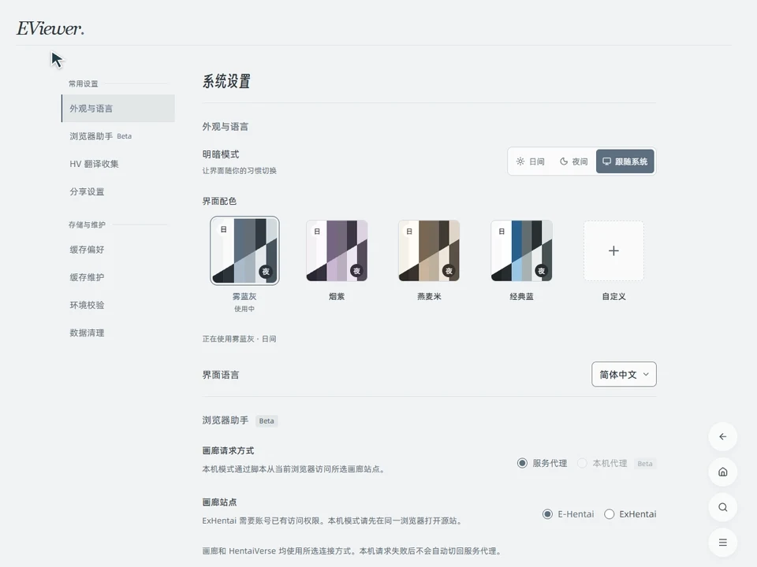

# 外观与 PWA

[返回首页](../../README.md) · [首次使用](../getting-started.md)

## 设置外观

在「系统设置 → 外观与语言」调整界面：

- **明暗模式**：选择「日间」「夜间」或「跟随系统」。
- **界面配色**：选择预设主题。
- **界面语言**：切换中文或英文。

外观设置保存在当前浏览器。换浏览器或清理站点数据后需要重新设置，这些偏好不会随账号同步。

### 自定义配色

1. 在「界面配色」选择「自定义」。
2. 切换「日间配色」或「夜间配色」，调整各项颜色。
3. 查看弹窗内的实时预览。
4. 点击「保存并使用」。

已使用自定义主题时，可点击「编辑配色」继续调整。点击「取消」不会保存本次修改。日间、夜间配色分别设置，避免只修改一种模式后，另一种模式仍不符合预期。

## 使用独立窗口

EViewer 提供 PWA 配置。在浏览器提供安装入口时，可通过该入口安装；在支持添加到主屏幕的设备上，也可以从浏览器菜单添加。具体入口名称由浏览器和系统决定。

安装后可从桌面或主屏幕启动，以独立窗口使用。

PWA 会缓存部分应用资源；加载画廊、图片和 HentaiVerse 内容时需要联网。

## 浏览器助手与 PWA 的区别

PWA 负责应用的打开方式；浏览器助手负责使用当前浏览器的源站会话。安装其中一个，不会自动获得另一个的能力。

- 桌面端：在支持扩展的浏览器普通标签页安装和使用助手。
- Android：本机模式需要支持所需扩展的浏览器。
- iPhone、iPad：按「浏览器助手」页面指引，在 Safari 普通标签页安装和使用 Userscripts。

使用浏览器助手时，请在支持扩展的普通标签页打开 EViewer。连接方式见[首次使用](../getting-started.md)。

## 存储与缓存

在「系统设置 → 环境校验」可以查看 IndexedDB 是否可用及存储配额，并重新检测。

无痕模式、浏览器限制或空间不足会影响本地存储。清理站点数据会删除本地阅读记录和缓存，重新安装 PWA 不会恢复这些数据。
