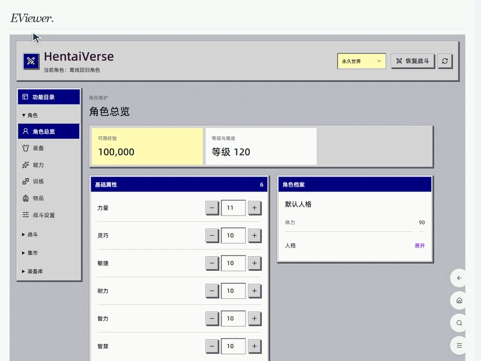

# HentaiVerse

[返回首页](../../README.md) · [首次使用](../getting-started.md)

EViewer 提供 HentaiVerse 的角色、装备、物品与战斗入口。游戏操作直接作用于源站账号；购买、训练或使用材料前，请核对确认框中的费用。

## 连接与登录

HentaiVerse 与画廊使用同一套连接方式。在「账号信息」完成当前模式的登录验证后，再进入 HentaiVerse。

使用「本机代理」时，先安装或更新浏览器助手，并在同一浏览器打开 HentaiVerse 源站确认登录。页面中的「连接说明」提供源站和助手设置入口。本机连接失败不会自动切换为服务代理。

## 选择世界与功能

页面顶部可选择「永久世界」或「异世界」。不同世界提供的入口不同，例如「训练」只在永久世界显示，「塔挑战」只在异世界显示。

桌面端通过左侧「功能目录」切换页面；窄屏设备先选择「角色」「战斗」「集市」或「装备库」分区，再选择具体功能。

| 分区 | 常用入口 |
| --- | --- |
| 角色 | 角色总览、装备、能力、训练、物品、战斗设置 |
| 战斗 | 竞技场、鲜血之环、混战祭、装备界，以及对应世界的挑战 |
| 集市 | 物品商店、市场、神殿、怪物实验室、莫古邮件等 |
| 装备库 | 装备维护 |

可用功能还受源站账号、世界和当前状态影响。页面顶部显示当前角色，可用刷新按钮重新获取当前页面。

## 查看与调整角色

「角色总览」用于查看角色状态。「装备」可切换套装、查看槽位及装备属性，并进行穿戴或卸下操作；属性加载失败时，按页面提示重试。

「能力」「物品」「训练」分别管理对应配置。提交后应核对页面返回的结果，不要在尚未收到响应时连续提交。训练、能力重置等操作可能有费用或状态要求，以源站返回和确认提示为准。

## 战斗状态

进入挑战前，确认框会显示可获取到的轮数和入场消耗。确认「开始战斗」后会进入战斗；只想查看条件时选择「暂不进入」。

如果账号已有进行中的战斗，点击页面顶部「恢复战斗」。源站会在战斗期间锁定部分角色维护页面；遇到这一提示时，应完成或退出当前战斗，再重新加载装备和角色配置。

各项操作的可用性取决于等级、资源、源站规则及当前任务状态。

## 加载或提交失败

1. 检查顶部世界和当前角色是否正确。
2. 返回「账号信息」验证当前连接模式的登录状态。
3. 本机模式检查助手是否已连接、是否与当前站点版本一致。
4. 刷新当前页面，核对源站结果后再决定是否重试。

遇到请求超时，尤其是购买、训练或消耗材料的操作，不要直接反复提交。先刷新页面确认操作是否已经生效。
