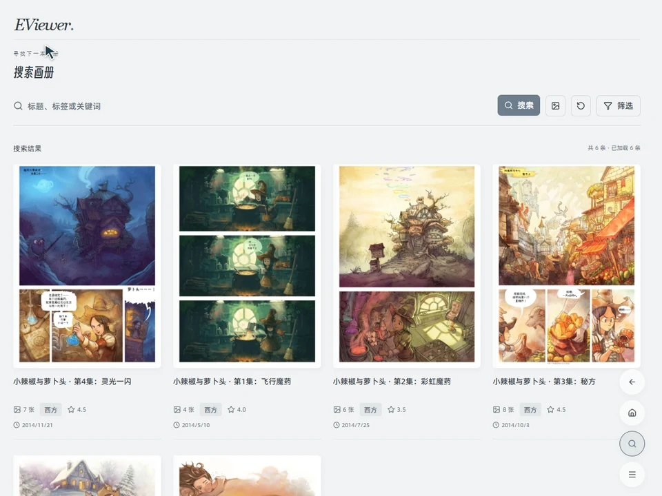
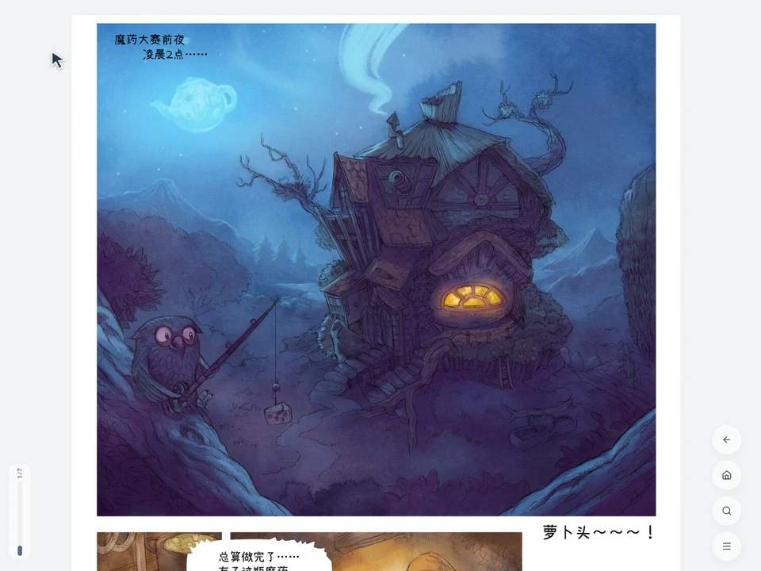

# 搜索与阅读

[返回首页](../../README.md) · [首次使用](../getting-started.md)

## 搜索画册

在「搜索画册」输入标题、标签或关键词，点击「搜索」。结果向下滚动时继续加载，点击画册进入详情。

需要缩小范围时，打开「筛选」：

- **分类与最低评分**：限定画册类别和评分。
- **标签筛选**：分别添加包含、排除标签；包含标签可以选择「包含全部」或「包含任意」。
- **内容条件**：填写标题、上传者、上传者 UID 或页数范围。
- **源站过滤**：选择是否要求存在种子、显示已移除内容，以及是否忽略账号原有的语言、上传者或标签过滤。

筛选面板里的修改先保留在草稿中，点击「应用筛选」才会更新结果。「取消」退出本次编辑；「重置筛选」清除面板中的条件，仍需应用。

结果上方会显示已应用的条件。没有找到内容时，可先减少条件，再检查当前选择的是 E-Hentai 还是 ExHentai。

图中按最少 6 页筛选，将六个章节缩小到四个。

### 图片搜索

点击搜索框旁的「图片搜索」，选择一张不超过 15 MB 的图片：

- 「精确匹配」：浏览器计算文件的 SHA-1，以文件哈希向源站查询，不上传原图。
- 「近似搜索」：上传图片交给源站匹配，需要时勾选「仅封面」。

两种方式都需要网络请求。近似搜索不要使用包含个人信息的图片。

### 搜索失败

搜索失败时，页面可能保留上一次结果，并标注「上次结果」。它不是本次搜索成功的结果。可点击「重试」；后续列表加载失败时使用「重试加载」，无需从头搜索。

## 开始阅读

在画册详情查看标题、页数、标签等信息，点击「开始阅读」。阅读器按顺序连续显示图片，向下滚动会加载后续内容。

点击阅读进度，输入目标页码并跳转。页码必须是 1 到总页数之间的整数。跳转或恢复到中间位置后，如果需要查看前文，可以使用「加载前面的图片」。

图中从《灵光一闪》第 1 页跳转到第 5 页。

### 继续上次阅读

在「系统设置 → 缓存偏好」开启 IndexedDB 和「记录浏览历史」后，EViewer 会记录看过的图片与阅读位置。再次进入时，可选择「继续阅读」或「从头阅读」；从继续阅读入口打开时会直接定位。

预加载图片不会直接算作已读。阅读历史保存在当前浏览器。清除站点数据会一并删除记录。

### 图片加载失败

- 单张图片失败：点击「图片加载失败，点击重试」。
- 后续图片失败：点击「重试后续图片」。
- 整个阅读器无法加载：点击「重新加载」，或返回列表重新打开画册。

重复失败时，先检查当前连接和登录状态，参见[排障](../troubleshooting.md)。

## 分享与下载

画册详情提供分享和下载入口。分享图片中的二维码可指向本站或源站，在「系统设置 → 分享设置 → 默认链接类型」选择。

下载页列出源站提供的种子资源；没有可用资源时会显示空列表。「源站下载」页签暂未开放。

在 iPhone、iPad 的独立 Web App 中，下载操作会尝试调用系统分享；无法调用时会复制链接，按提示到 Safari 打开。
